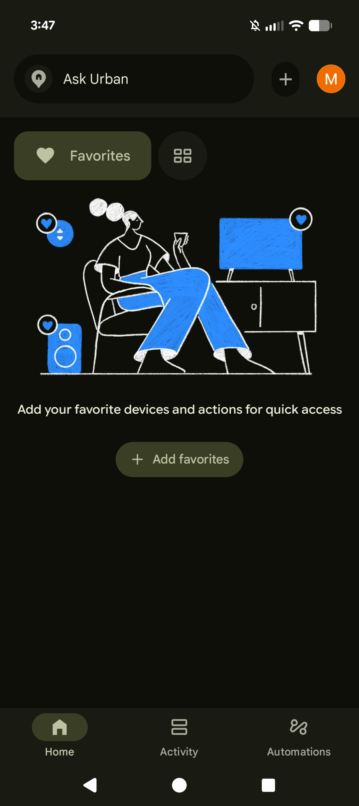

# Setting up and Connecting Apps to a Google Home
I own some WiZ lights which can have their functionality controlled by things like a Google Home Mini which I also happen to now own. I wanted to set up the Mini along with connect the Wiz lights to the Google Home so that I would be able to control the lights by speaking with the mini instead of needing to use the WiZ app.

### Setting up the Speaker
The home screen was almost empty, so I scanned it for anything that looked like it would either add something or had to do with devices. I saw the + in the top right of the screen and since in pretty much every thing I have ever used that means add and I associate it with that because of math I clicked on it. A menu appeared from the bottom of the screen which had Device as an option and so I selected it.

The app had already found two nearby devices one of which being my Mini and the other was someone else's Nest Hub. After selecting my device the rest was pretty simple, as it mostly ran through steps on its own while telling me what is was doing. It did at one point play a sound out of the Mini and asked me if I had heard the sound, so that I could make sure I selected the correct device. I liked this aspect of **visibility of system status**, since if there had been multiple Mini's to select from I would not have known which was which depending on how people named the device.

I ran into an issue when trying to connect the device to my Wi-Fi network. The app said it would automatically grab the password from my phone, but it came back with a "Connection problem during setup" error. This was weird because after the fact I manually typed in my password and it connected immediately, it makes me wonder why it had an issue automatically grabbing the password like it said it would. The error message could be better to point out what went wrong since telling me to check my password when it would grab it automatically and was not something I entered is not very helpful.

### Connecting the Lights
Next I wanted to connect the WiZ lights with the Google Home app. Since after setting up the Mini I was returned to the homepage I once again clicked on the + symbol in the top right as I remembered from earlier that there was an option for "Link app or service" and I clicked on that. That took me to a page called Services with options like Linked apps, Works with Google, Video, Music, and Radio. I use the WiZ app to control my lights and so clicked on Linked apps since it seemed like the option I needed. I was then redirected out of the app and to a webpage that essentially just said "No partner apps linked to this home." I then backed out with the navigation arrows that are always at the bottom of my screen.

This is where my **mental model** broke down, as the way that I expected the process of how I needed to connect the app was not in line with the  **conceptual model** of how the process was actually designed. The way to actually connect the app was under Works with Google, but there was no real descriptive difference between what Linked apps, Works with Google, and Partner Connected were. A small blurb under each of those about what aspect they actually cover would help with bridging the gap between how I expected it work and how it does. After clicking on Works with Google I was taken to a page which was a list of all the apps that I could connect to the Google Home. WiZ was at the top of the page under a section called Linked Services. After clicking on it I was given a prompt to either Reconnect account or unlink account, and since I wanted it connect I chose the first option. After that I was taken through a few pages which just had me confirming which permissions I would be fine with getting shared between the two different software's so that they could talk to each other. Then just needed to select the room that they belonged to within the Google Home and the lights were fully connected.

### What I'd Change
The setting up of the speaker was mostly smooth, and I did appreciate the sound check since if multiple of the same device were on the selection list it would be difficult to tell which is which. The most trouble from all of this came from the wording. Like with the error message when connecting to the Wi-Fi it would be better to say something like "Couldn't get your saved Wi-Fi password" instead of saying the password is incorrect. The Linked apps section should also be less of a dead end, as I went back to it after linking the WiZ app and it didn't appear in that area. So the purpose of it is just generally confusion and kind of misleading as the app I linked does not appear there. Also a message on there to tell you if you want to link an app to Home to go to Works with Google would be nice as this feels like it would be a common error. There could also just be small blurbs under each of the different options in the Services page to give a bit more description than just the name.
